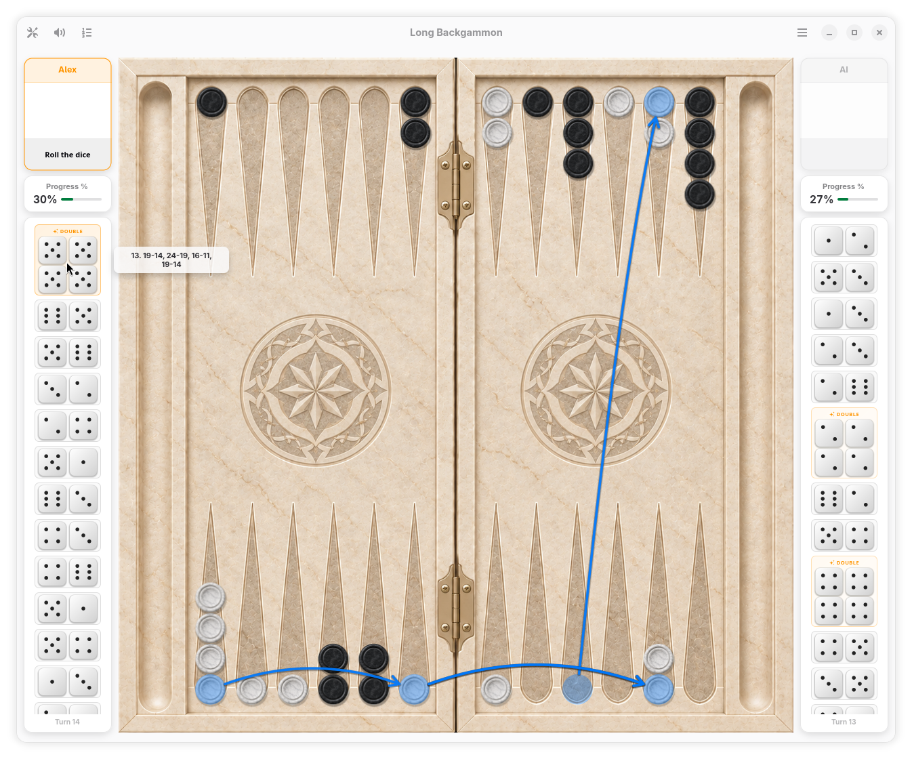
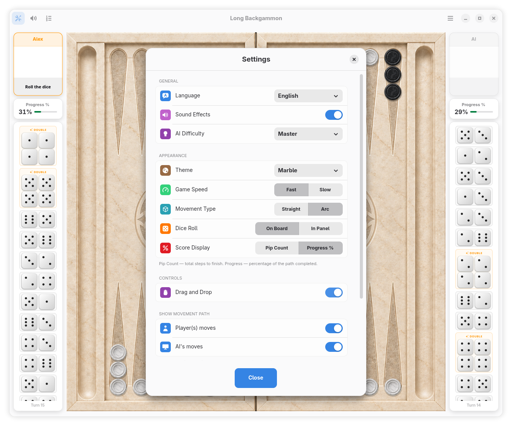
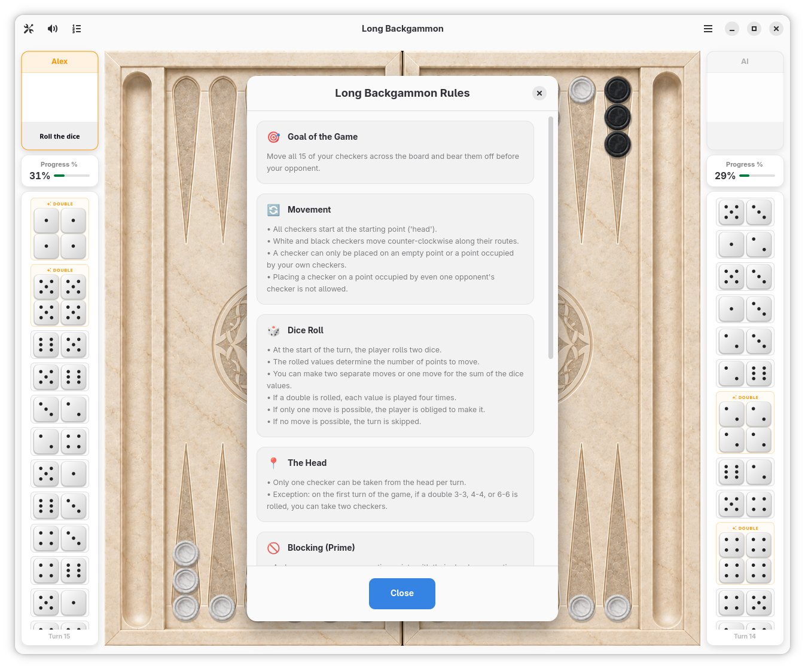

# Long Backgammon

[](https://github.com/ansribas/LongBackgammon/actions/workflows/ci.yml)
[](https://www.gnu.org/licenses/gpl-3.0)

> 🇷🇺 **[Читать на русском](README.ru.md)**

Classic Long Backgammon (Russian Nardi / Длинные нарды) for GNOME/Linux (GTK4 + Libadwaita) featuring authentic rules, fluid animations, and advanced AI.

<p align="center">
  
</p>

---

## Screenshots

<p align="center">
  <a href="data/screenshots/01.png"></a>
  <a href="data/screenshots/02.png"></a>
  <a href="data/screenshots/03.png"></a>
</p>

---

## Features

* **Game Modes**:
  * Play against the computer with two difficulty levels: **Casual** and **Grandmaster**.
  * Local two-player mode on a single device (**Hotseat**).
* **Authentic Long Backgammon Rules**:
  * One-checker-from-the-head rule (with support for opening double exceptions: 3-3, 4-4, 6-6).
  * Initial roll-off to determine who moves first.
  * Strict blockade rule (a 6-point prime is prohibited unless the opponent has at least one checker ahead of it).
  * Official match scoring: Normal win (*Oin*), *Mars* (gammon), and *Home Mars* (backgammon).
* **Gameplay & Visual Polish**:
  * Doubles (*Kush*) award four moves with badges and animations.
  * Combined moves matching the total sum of unused dice.
  * 3D dice rolling physics overlay with realistic bounce and tray arrival.
  * Drag & Drop checker movements with magnetic snap-to-target.
  * Move trajectory preview arrows when hovering over game log rows.
  * Undo functionality, real-time game log, and automatic game state preservation.
* **Themes & Customization**:
  * Board and checker themes: **Wood** and **Marble**.
  * Custom mouse cursor displaying current dice values.
  * Settings: 14 interface languages, adjustable animation speed, sound effects, and score/pip display modes.
  * Comprehensive match statistics and win rate tracking.

---

## Installation

Pre-built packages for Linux are available on the **[Releases](https://github.com/ansribas/LongBackgammon/releases)** page.

### Flatpak (.flatpak) — Recommended
Universal bundle compatible with any modern Linux distribution:
```bash
flatpak install io.github.ansribas.LongBackgammon.flatpak
```
Run:
```bash
flatpak run io.github.ansribas.LongBackgammon
```

### AppImage (.AppImage)
Standalone portable executable that requires no installation:
1. Download `LongBackgammon-*-x86_64.AppImage` from Releases.
2. Make it executable:
   ```bash
   chmod +x LongBackgammon-*-x86_64.AppImage
   ```
3. Launch via double-click in your file manager or from terminal:
   ```bash
   ./LongBackgammon-*-x86_64.AppImage
   ```

### Debian / Ubuntu (.deb)
Native package for Debian, Ubuntu, Linux Mint, and derivatives:
```bash
sudo apt install ./longbackgammon_*_amd64.deb
```

---

## Building from Source

To compile the game manually from source:

1. **Dependencies**:
   * **Fedora / RHEL**:
     ```bash
     sudo dnf install meson ninja-build vala gtk4-devel libadwaita-devel
     ```
   * **Ubuntu / Debian**:
     ```bash
     sudo apt install meson ninja-build valac libgtk-4-dev libadwaita-1-dev
     ```
   * **Arch Linux**:
     ```bash
     sudo pacman -S meson ninja vala gtk4 libadwaita
     ```

2. **Build and Run**:
   ```bash
   meson setup build
   ninja -C build
   ./build/src/longbackgammon
   ```

3. **Install system-wide (optional)**:
   ```bash
   sudo ninja -C build install
   ```

---

## Support the Project

If you enjoy Long Backgammon, you can support development on **[Ko-fi](https://ko-fi.com/ansribas)**.

---

## License

[GNU General Public License v3.0 or later (GPL-3.0-or-later)](COPYING)
