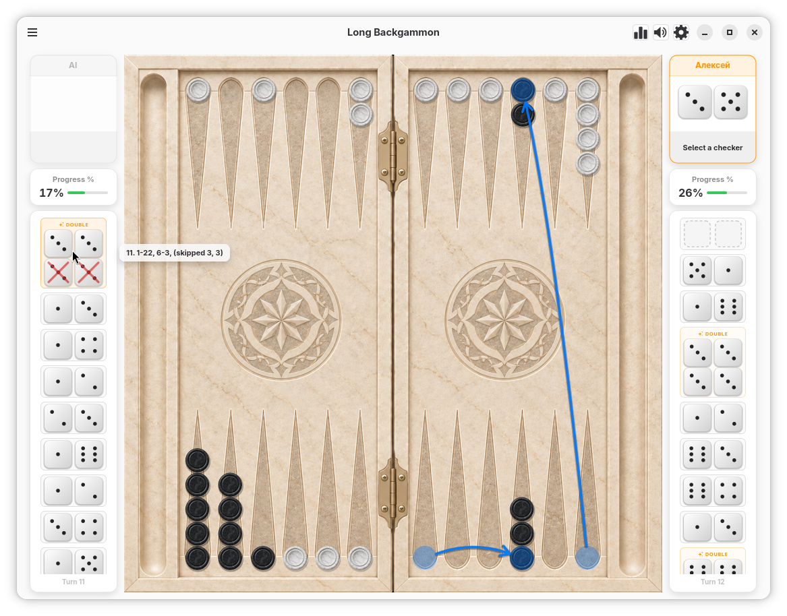
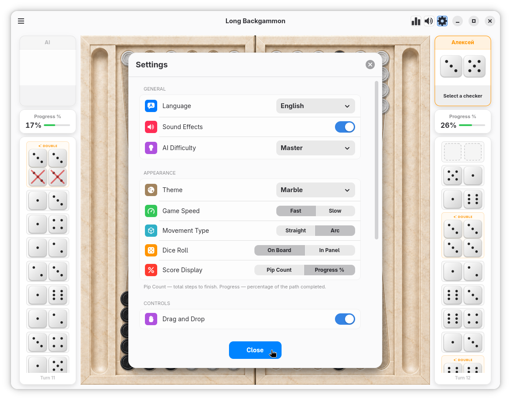
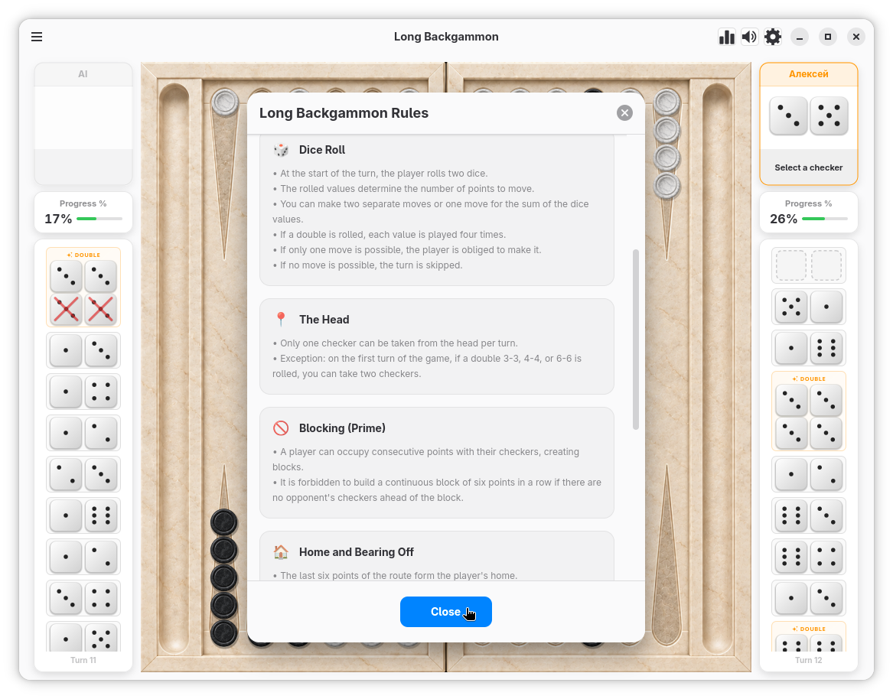

# Long Backgammon

[](https://github.com/ansribas/LongBackgammon/actions/workflows/ci.yml)
[](https://www.gnu.org/licenses/gpl-3.0)

> 🇷🇺 **[Читать на русском](README.ru.md)**

Classic Long Backgammon (Russian Nardi / Длинные нарды) for GNOME/Linux (GTK4 + Libadwaita) featuring authentic rules, fluid animations, and advanced AI.

<p align="center">
  
</p>

---

## Screenshots

<p align="center">
  <a href="data/screenshots/01.png"></a>
  <a href="data/screenshots/02.png"></a>
  <a href="data/screenshots/03.png"></a>
</p>

---

## Features

* **Game Modes**:
  * Play against the computer with two difficulty levels: **Casual** and **Grandmaster**.
  * Local two-player mode on a single device (**Hotseat**).
* **Authentic Long Backgammon Rules**:
  * One-checker-from-the-head rule (with support for opening double exceptions: 3-3, 4-4, 6-6).
  * Initial roll-off to determine who moves first.
  * Strict blockade rule (a 6-point prime is prohibited unless the opponent has at least one checker ahead of it).
  * Official match scoring: Normal win (*Oin*), *Mars* (gammon), and *Home Mars* (backgammon).
* **Gameplay & Visual Polish**:
  * Doubles (*Kush*) award four moves with badges and animations.
  * Combined moves matching the total sum of unused dice.
  * 3D dice rolling physics overlay with realistic bounce and tray arrival.
  * Drag & Drop checker movements with magnetic snap-to-target.
  * Move trajectory preview arrows when hovering over game log rows.
  * Undo functionality, real-time game log, and automatic game state preservation.
* **Themes & Customization**:
  * Board and checker themes: **Classic**, **Wood**, and **Marble**.
  * Custom mouse cursor displaying current dice values.
  * Settings: 14 interface languages, adjustable animation speed, sound effects, and score/pip display modes.
  * Comprehensive match statistics and win rate tracking.

---

## Project Structure

```text
.
├── data/              # Application assets & metadata
│   ├── icons/         # FreeDesktop hicolor icons (SVG & PNG)
│   ├── images/        # High-res board textures, checkers, and cursors
│   ├── sounds/        # Audio effects (WAV)
│   ├── translations/  # In-game localization files (JSON, 14 languages)
│   └── io.github.ansribas.LongBackgammon.* # Desktop entry, AppStream metainfo, GSettings schema
├── po/                # Gettext translations for system UI and metadata
├── src/               # Application source code (Vala)
│   ├── logic/         # Game engine (pure models & business logic)
│   │   ├── models.vala            # Enums, point coordinates, move structures
│   │   ├── game_board.vala        # Board state, point stacks, bearing-off trays
│   │   ├── move_validator.vala    # Rule validator & legal move generation
│   │   ├── game_session.vala      # Match state machine, turn orchestration
│   │   ├── computer_ai.vala       # Standard heuristic AI
│   │   ├── advanced_ai.vala       # Grandmaster AI (prime building, risk analysis)
│   │   ├── settings_store.vala    # Preferences & player profile persistence
│   │   ├── stats_store.vala       # Match results & outcome statistics
│   │   ├── saved_game_store.vala  # Unfinished game serialization & restore
│   │   ├── game_log_store.vala    # Move history and game log storage
│   │   ├── sound_manager.vala     # Sound playback engine (GStreamer / Canberra)
│   │   └── localization_manager.vala # In-app JSON multi-language manager
│   ├── ui/            # User interface (GTK4 / Libadwaita)
│   │   ├── board_view.vala        # Board canvas & checker animation rendering (Cairo)
│   │   ├── dice_overlay.vala      # Fullscreen 3D dice physics and landing animation
│   │   ├── player_panel.vala      # Player panels (avatars, status, turn timers)
│   │   ├── player_dice_zone.vala  # Dice slot container and fly-in animation layer
│   │   ├── player_score_block.vala# Score display and turn progress indicator
│   │   ├── log_views.vala         # Game log view & trajectory hover tooltips
│   │   ├── popup_view.vala        # Modal dialog base overlay container
│   │   ├── settings_view.vala     # Settings modal (themes, speed, audio, language)
│   │   ├── rules_view.vala        # Interactive rules guide dialog
│   │   ├── statistics_view.vala   # Detailed player statistics modal
│   │   ├── new_game_dialogs.vala  # New game setup, confirm, and resume dialogs
│   │   ├── game_over_view.vala    # Victory/defeat screen with animated particle celebration
│   │   └── ui_kit.vala            # Animation utilities (Bezier, spring physics), colors & styles
│   ├── application.vala           # Adw.Application subclass (GActions, shortcuts)
│   ├── main.vala                  # Application entry point
│   └── window.vala                # Main application window (Adw.ApplicationWindow)
├── tests/             # Automated test suite
│   ├── logic_test.vala   # Core rule validation & AI decision tests
│   ├── session_test.vala # Asynchronous game session & turn progression tests
│   └── ui_test.vala      # Interactive board UI component test
├── io.github.ansribas.LongBackgammon.json # Flatpak manifest for GNOME Builder
└── meson.build        # Meson build system configuration
```

---

## Building and Running

### 1. Install Dependencies

* **Fedora / RHEL**:
  ```bash
  sudo dnf install meson ninja-build vala gtk4-devel libadwaita-devel
  ```

* **Ubuntu / Debian**:
  ```bash
  sudo apt install meson ninja-build valac libgtk-4-dev libadwaita-1-dev
  ```

* **Arch Linux**:
  ```bash
  sudo pacman -S meson ninja vala gtk4 libadwaita
  ```

### 2. Build from Source

```bash
# Configure the build directory
meson setup build

# Compile
ninja -C build

# Run directly without installing
./build/src/longbackgammon

# Install system-wide (optional)
sudo ninja -C build install
```

### 3. Build with GNOME Builder / Flatpak

The repository includes a ready-to-use Flatpak manifest:
1. Open the project directory in **GNOME Builder**.
2. Allow Builder to download the GNOME 48 Flatpak SDK runtime.
3. Click **Run** (or press `Ctrl+F5`).

---

## Testing

The project includes 6 automated test suites (rule verification, AI moves, UI components, and metadata validation):

```bash
meson test -C build
```

To run tests with verbose logging:
```bash
meson test -C build -v
```

---

## Controls and Shortcuts

| Action | Input |
|---|---|
| Roll Dice / New Game | Click on board or <kbd>Space</kbd> |
| Select Checker | Left mouse click |
| Move Checker | Click on highlighted point or Drag & Drop |
| Smart Move (highest die) | Double click checker |
| Bear Off Checker | Click on the bearing-off tray (right side of board) |
| Preview Move Trajectory | Hover cursor over a move history row |
| Undo Move | <kbd>Ctrl</kbd> + <kbd>Z</kbd> |
| New Game | <kbd>Ctrl</kbd> + <kbd>N</kbd> |
| Preferences | <kbd>Ctrl</kbd> + <kbd>,</kbd> |
| Statistics | Statistics button in menu or headerbar |
| Keyboard Shortcuts | <kbd>Ctrl</kbd> + <kbd>?</kbd> |

---

## Data Storage

User configuration and session state are stored in `~/.local/share/longbackgammon/`:
* `settings.ini` — Player preferences (AI level, language, visual themes).
* `stats.ini` — Cumulative wins, losses, and victory types.
* `saved_game.ini` — Serialized state of any active, unfinished match.
* `game_logs.ini` — Archive of completed matches.

---

## License

[GNU General Public License v3.0 or later (GPL-3.0-or-later)](COPYING)
