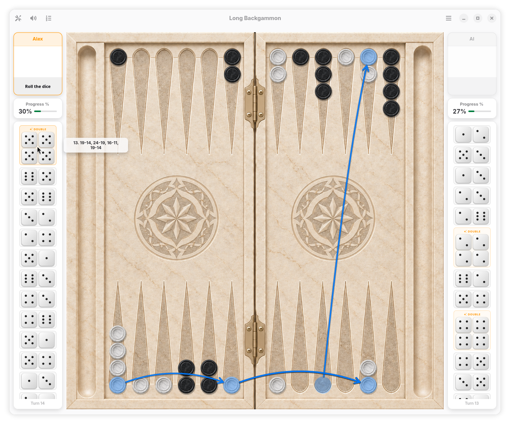
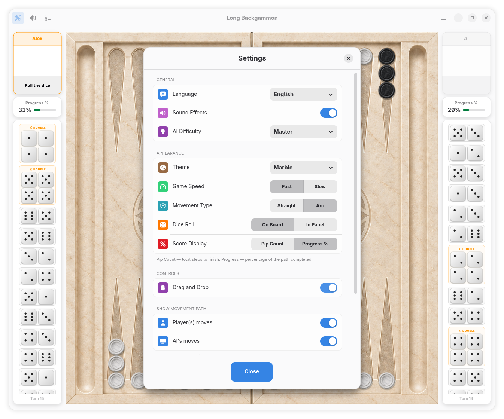
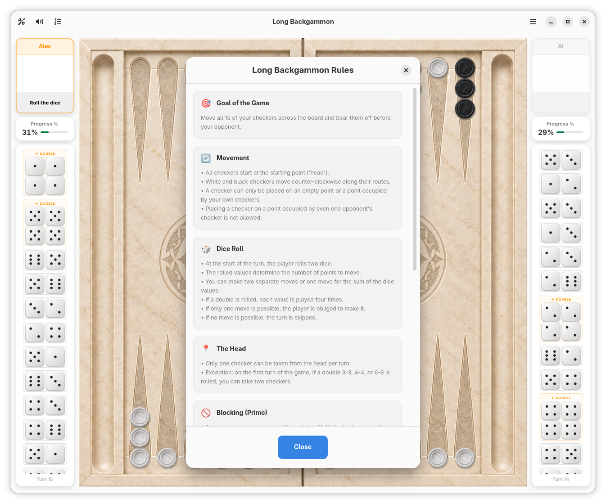

# Long Backgammon (Длинные нарды)

[](https://github.com/ansribas/LongBackgammon/actions/workflows/ci.yml)
[](https://snapcraft.io/longbackgammon)
[](https://copr.fedorainfracloud.org/coprs/ansvet/longbackgammon/)
[](https://www.gnu.org/licenses/gpl-3.0)

> 🇬🇧 **[Read in English](README.md)**

Классические русские (длинные) нарды для GNOME/Linux (GTK4 + Libadwaita) с аутентичными правилами, плавной анимацией и продвинутым искусственным интеллектом.

<p align="center">
  
</p>

---

## Скриншоты

<p align="center">
  <a href="data/screenshots/01.png"></a>
  <a href="data/screenshots/02.png"></a>
  <a href="data/screenshots/03.png"></a>
</p>

---

## Возможности

* **Режимы игры**:
  * Против компьютера (два уровня сложности ИИ: «Обычный» и «Гроссмейстер»).
  * Против другого игрока на одном устройстве (Hotseat).
* **Классические правила длинных нард**:
  * Взятие только одной фишки с «головы» за ход (с поддержкой правила первого хода для дублей 3-3, 4-4, 6-6).
  * Розыгрыш права первого хода (Roll-off).
  * Правило полного запрета «запирания» (нельзя строить блок из 6 фишек, если впереди нет фишки соперника).
  * Подсчёт исходов: обычная победа (Оин), Марс и Домашний марс.
* **Игровой процесс и анимации**:
  * Куш (дубль) — четыре хода с бейджем и анимацией.
  * Комбинированные ходы на суммарное значение кубиков.
  * Плавные анимации перелёта кубиков в лог, подсказки возможных ходов и стрелки траекторий при наведении на историю.
  * Отмена хода (Undo), динамический лог партии, автосохранение незавершённой игры.
* **Кастомизация и оформление**:
  * Темы доски и фишек: *Дерево*, *Мрамор*.
  * Кастомный курсор с отображением выпавших кубиков.
  * Настройки: выбор языка интерфейса (14 языков), скорость анимаций, звуковые эффекты, режим счёта (очки/прогресс).
  * Детальная статистика побед и поражений.

---

## Установка

### Snap (Snap Store) — Универсальный пакет для Linux
Доступен напрямую в каталоге [Snap Store](https://snapcraft.io/longbackgammon):
```bash
sudo snap install longbackgammon
```

### Fedora (COPR)
Нативный RPM-репозиторий для Fedora 44, Fedora 45 и Rawhide:
```bash
sudo dnf copr enable ansvet/longbackgammon
sudo dnf install longbackgammon
```

### Flatpak (.flatpak) — Рекомендуемый способ для оффлайн-установки
Универсальный пакет, работающий в любом дистрибутиве Linux:
```bash
flatpak install io.github.ansribas.LongBackgammon.flatpak
```
Запуск:
```bash
flatpak run io.github.ansribas.LongBackgammon
```

### AppImage (.AppImage)
Не требует установки — портативный файл:
1. Скачайте `LongBackgammon-*-x86_64.AppImage` со страницы [Релизов (Releases)](https://github.com/ansribas/LongBackgammon/releases).
2. Сделайте файл исполняемым:
   ```bash
   chmod +x LongBackgammon-*-x86_64.AppImage
   ```
3. Запустите двойным кликом в файловом менеджере или командой:
   ```bash
   ./LongBackgammon-*-x86_64.AppImage
   ```

### Debian / Ubuntu (.deb)
Пакет для Debian, Ubuntu, Linux Mint и производных (доступен на странице [Релизов](https://github.com/ansribas/LongBackgammon/releases)):
```bash
sudo apt install ./longbackgammon_*_amd64.deb
```

---

## Сборка из исходников

Если вы хотите собрать игру вручную:

1. **Зависимости**:
   * **Fedora / RHEL**:
     ```bash
     sudo dnf install meson ninja-build vala gtk4-devel libadwaita-devel
     ```
   * **Ubuntu / Debian**:
     ```bash
     sudo apt install meson ninja-build valac libgtk-4-dev libadwaita-1-dev
     ```
   * **Arch Linux**:
     ```bash
     sudo pacman -S meson ninja vala gtk4 libadwaita
     ```

2. **Сборка и запуск**:
   ```bash
   meson setup build
   ninja -C build
   ./build/src/longbackgammon
   ```

3. **Установка в систему (опционально)**:
   ```bash
   sudo ninja -C build install
   ```

---

## Поддержка проекта

Если вам нравятся «Длинные нарды», вы можете поддержать разработку на платформе **[Ko-fi](https://ko-fi.com/ansribas)**.

---

## Лицензия

[GNU General Public License v3.0 или более поздняя (GPL-3.0-or-later)](COPYING)
